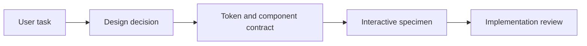

# Product judgment, made reusable

These public case studies summarize selected design rules from Kenny’s ChatDaddy and BobWork work. They contain newly authored, fictional specimens rather than customer screenshots, internal research or production application code.

| | ChatDaddy | BobWork |
| --- | --- | --- |
| Product problem | Keep communication and operational workflows understandable as modules grow | Help users understand and configure a modular service offer |
| Main design focus | Task-first navigation, information timing, table density and explicit UI states | Package comparison, selectable skills, pricing hierarchy and clear commitment |
| Representative primary color | `#0F5BFF` | `#2F54FF` |
| Reusable decisions | Separate navigation scope; distinguish empty, loading and error states; reveal help when relevant | Distinguish setup, recurring and usage charges; keep selections legible; maintain a visible summary |
| Evidence status | Handbook and reusable implementation packages; do not infer full production migration | Component library and interactive configurator design prototype |

## ChatDaddy: design around the current task

A messaging product contains several different moments: first use, configuration, active work and a return visit. A universal dashboard can hide the action that matters. The system describes page families, navigation scope and when to disclose information so the interface answers the user’s current question.

**Example:** an unconnected channel should explain the connection step. A connected channel with no messages needs a different empty state. A failed connection needs a recovery action, not an empty inbox.

The source work includes foundations, authored module icons, utility icons, navigation and Inbox primitives, interaction states, content timing and governance. The public specimen is a newly authored example; it does not assert that all proposed rules have shipped to the application.

## BobWork: make an offer understandable before commitment

A modular offer combines setup effort, ongoing service and optional skills. The design separates these concepts instead of compressing them into one unexplained number.

**Example:** select a workflow skill, see that selection reflected in a summary, then review the offer. Smart defaults reduce blank-state effort; explicit states show what is included and what changes.

The source system defines ink and semantic colors, display/body/mono type roles, core components, stage cards, skill rows, summary bars and feedback states. Its configurator remains design/prototype evidence; commercial conversion improvements have not been measured here.

## From design direction to implementation

A useful system explains why a rule exists, shows the rule in context and states what remains unverified. That gives designers, engineers and AI coding tools a common reference.

## Provenance and scope

Reviewed source snapshots: ChatDaddy handbook `1.3.0-draft.1` and token definitions; BobWork design-system repository `bobwork-design-system-2026-08-07`, its overview and color tokens. Only selected non-sensitive design facts are summarized. Neither internal repository is republished. The public site’s existing generic CRM remains an illustrative example.
